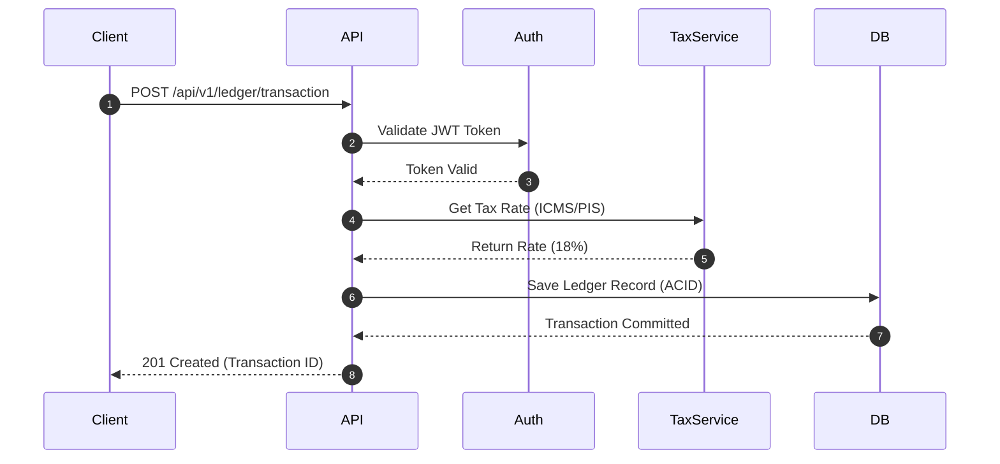
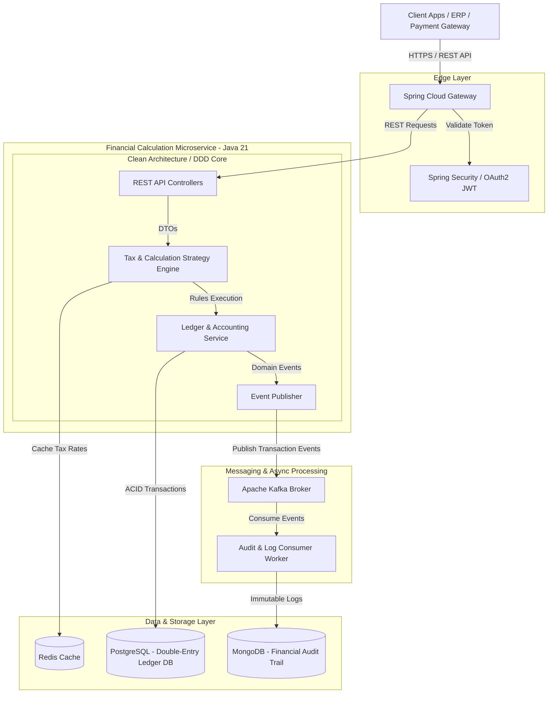

# model-finace-java
Financial systems review, IT auditing, and digital forensics.

# Hi there, I'm Isaque Oliveira 👋

### Senior Software Engineer | Financial Systems & Digital Forensics Specialist

I am a Senior Software Engineer with over 7 years of experience building high-throughput distributed systems, event-driven architectures, and ACID-compliant financial engines. My core differentiator lies at the intersection of **scalable software development, financial IT audit, tax compliance, and forensic data integrity**.

Former **Senior Tax Consultant at Michelin** and **Court-Appointed Judicial Expert**, I combine deep hands-on engineering execution with an auditor's analytical mindset to build bulletproof, transparent, and audit-ready enterprise software.

---

### 🛠️ Core Tech Stack & Ecosystem
--

Microservice

